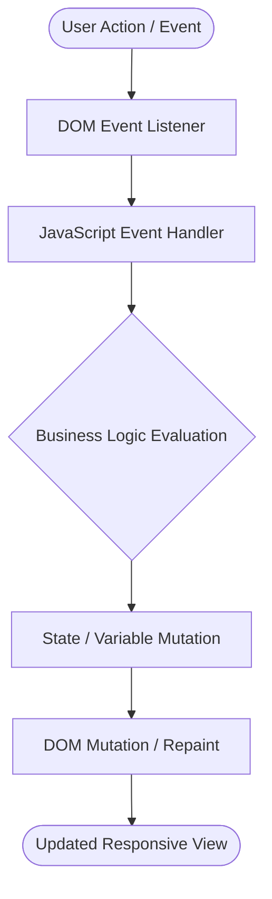

<p align="center">
  
</p>

<p align="center">
  
  
  
  
  
</p>

---

## Executive Summary / Overview
### Problem Statement & Context
Modern full-stack web applications demand an uncompromising mastery of foundational frontend technologies. Developers who rely solely on heavy JavaScript abstractions without a rock-solid understanding of the DOM (Document Object Model), browser event loops, and responsive layout primitives often build sluggish, fragile user interfaces.

### Solution Overview
This repository comprises an extensive **Full-Stack Development (FSD) Laboratory Suite** featuring **28 functional web application modules**. From interactive utility tools (Calculators, Real-Time Digital Clocks, Interest Calculators) to full multi-screen business portals (Food Cafe, Hospital Booking UI, Rapido Transportation Clone), the codebase showcases semantic HTML5, modern CSS3 layout systems (Flexbox, Grid), and vanilla JavaScript ES6+ event-driven programming.

---

## Interactive Table of Contents
- [Executive Summary / Overview](#executive-summary--overview)
- [Key Features & Capabilities](#key-features--capabilities)
- [System Architecture / Pipeline](#system-architecture--pipeline)
- [Tech Stack Breakdown](#tech-stack-breakdown)
- [Reproducible Quickstart & Setup](#reproducible-quickstart--setup)
- [Project Directory Layout](#project-directory-layout)
- [Author & Contributions](#author--contributions)

---

## Key Features & Capabilities
- **28 Modular Web Applications:** Contains individual, fully functional frontend web apps demonstrating diverse DOM interactions.
- **Production UI Recreations:** Includes high-fidelity UI clones such as **Rapido Ride Booking** and **Hospital Patient Management**.
- **Responsive Layout Architecture:** Built using CSS Media Queries, responsive units (vw, vh, rem), and dynamic flexbox/grid containers.
- **Dynamic JavaScript Logic:** Implements client-side state handling, dynamic DOM node creation, real-time clock tickers, and input validation engines.

---

## System Architecture / Pipeline


---

## Tech Stack Breakdown
| Layer | Technology | Usage |
| :--- | :--- | :--- |
| **Languages** | HTML5, CSS3, JavaScript ES6+ | Semantic markup, responsive presentation, client-side logic |
| **Libraries** | Web Platform APIs | DOM API, Canvas, Audio/Video, Timer APIs |
| **Tools** | VS Code, Chrome DevTools | Layout debugging, network inspect, responsive profiling |
| **Architecture** | Event-Driven Frontend | Reactive DOM updates and decoupled component files |

---

## Reproducible Quickstart & Setup
```bash
# 1. Clone repository
git clone https://github.com/suryateja-155/FSD-Surya-teja.git
cd FSD-Surya-teja

# 2. Run with any local HTTP server (or double-click any .html file)
python -m http.server 8000

# 3. Open in your browser:
# Navigate to http://localhost:8000/Rapido.html
# Navigate to http://localhost:8000/Hospital.html
# Navigate to http://localhost:8000/Foodcafe.html
```

---

## Project Directory Layout
```text
FSD-Surya-teja/
├── Rapido.html                 # Ride-hailing web UI application
├── Rapido.css                  # Custom stylesheet for Rapido interface
├── Hospital.html               # Healthcare & patient booking portal
├── Foodcafe.html               # Restaurant menu and ordering interface
├── calculator.html             # Interactive mathematical calculator
├── Clock.html                  # Real-time ticking digital clock
├── simple intrest app...html   # Financial loan/interest calculator
├── DOM in js.html              # Core DOM tree manipulation experiments
├── RWD.html                    # Responsive Web Design demonstration
└── README.md                   # Complete laboratory overview and module index
```

---

## Author & Contributions

**Gettupalli Surya Teja**  
- GitHub Profile: [@suryateja-155](https://github.com/suryateja-155)  
- Portfolio Index: [Gettupalli-Surya-Teja](https://github.com/suryateja-155/Gettupalli-Surya-Teja)

Contributions, issue reports, and feedback are always welcome! Feel free to open an issue or pull request.

<p align="center">
  
</p>
